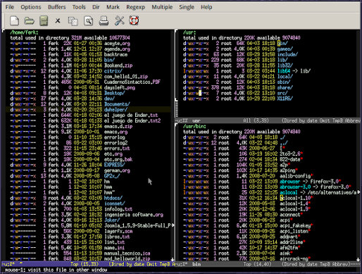
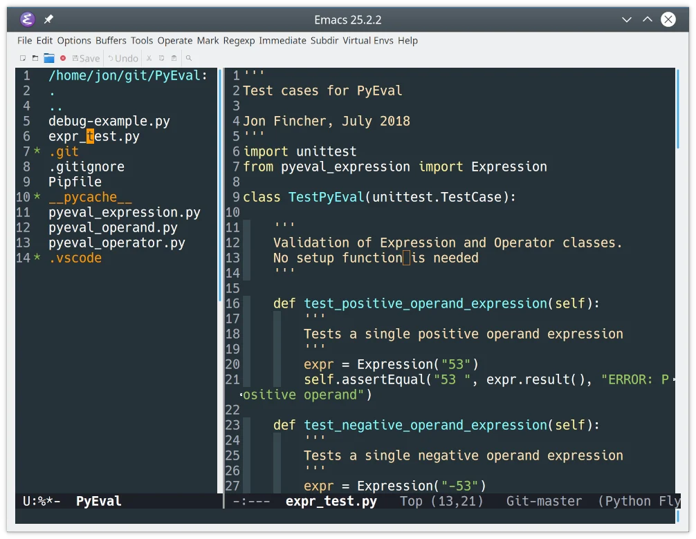

# GNU Emacs for Editing and Programmable Workflows

[](https://github.com/michelle8768/emacs-lisp/releases/)

GNU Emacs combines text editing with an extensible Lisp environment.
Use it for source code, structured notes, file navigation, and repeatable text operations.
The emacs text editor can adapt its behavior while the same editing session remains open.

## Editing Features

- Work with several files and temporary buffers in one session.
- Search text incrementally and replace repeated patterns.
- Use major modes for language-specific editing behavior.
- Combine minor modes for focused editing assistance.
- Record keyboard macros for repeated changes.
- Inspect commands and settings through built-in help.
- Organize notes and tasks with Org mode.
- Extend the editor through Emacs Lisp.

A buffer can contain a file, command output, documentation, or temporary text.



## Buffers, Windows, and Frames

These terms describe different parts of the editing environment.
Understanding them makes navigation and layout changes more predictable.

| Term | Meaning | Practical use |
| --- | --- | --- |
| Buffer | Text and associated editing state | Keep a source file or notes available |
| Window | A view displaying a buffer | Compare code with documentation |
| Frame | A top-level display area | Use another application window or terminal display |
| Major mode | The primary editing behavior of a buffer | Edit Python, Lisp, or prose |
| Minor mode | An additional behavior | Add pairing, completion, or visual assistance |

Several windows can display the same buffer.
Closing a window does not necessarily kill its buffer or save its contents.

## Graphical and Terminal Sessions

Emacs can run in a graphical frame or inside a terminal.
Available display features depend on the build and terminal capabilities.

The following Bash commands are separate examples for checking and comparing sessions:

```bash
emacs --version
emacs -Q notes.org
emacs -Q -nw notes.org
```

The first command reports the installed version.
The second opens a graphical session when supported; the third requests terminal display.
The -Q option skips personal and site initialization for a minimal comparison.

A clean session helps distinguish the editor's defaults from local customizations.

## Commands and Help

Command names provide another route to features beyond keyboard shortcuts.
Use M-x to invoke a command by name.

- C-h k explains the command attached to a key sequence.
- C-h f describes a function.
- C-h v describes a variable.
- C-h m describes active modes and their bindings.
- C-h r opens the Emacs manual.
- C-h t opens the interactive tutorial.

In this notation, C- means Control and M- means Meta, commonly Alt.
C-g cancels many incomplete commands or interrupts an operation.

Use C-x C-s to save the current file.
Use C-x C-c when you intend to leave Emacs, responding to any modified-buffer prompts.

## Configuration with Lisp

An emacs configuration can combine variable settings, mode activation, and hooks.
Use the initialization file selected by the installed Emacs environment.

This example changes indentation defaults and adds a few editing conveniences.
It uses built-in functions rather than requiring external packages.

```emacs-lisp
;;; init.el --- Editing preferences -*- lexical-binding: t; -*-
(setq-default indent-tabs-mode nil
              fill-column 88)
(column-number-mode 1)
(show-paren-mode 1)
(add-hook 'text-mode-hook #'visual-line-mode)
```

Spaces become the default indentation choice, and the mode line shows the column number.
Matching parentheses are highlighted in applicable buffers.
Text-mode buffers gain visual line wrapping without inserting line breaks into the file.

The fill-column value guides filling commands; it does not force every line to wrap.
Major modes and project settings can override buffer-local defaults.

## Extending Behavior

The emacs lisp environment lets you inspect and redefine editor behavior.
Evaluate a small change, observe its effect, and keep it only if it serves the workflow.

Hooks apply behavior when a mode or event becomes active.
Keymaps associate input sequences with commands.
Variables and faces control behavior and presentation.

After a change fails, consult the error message and the relevant function documentation.
A minimal configuration is easier to diagnose than several simultaneous changes.

## Notes and Tasks with Org

The emacs org mode workflow uses readable plain text for headings, tasks, and supporting notes.
Save this example in a file with the .org extension:

```org
* Project Review
** TODO Collect feedback
SCHEDULED: <2026-11-12 Thu>
** TODO Compare alternatives
Record the decision criteria before choosing an approach.
** DONE Gather background notes
```

Headings organize the outline, while TODO and DONE indicate task state.
The scheduled timestamp can appear in agenda views when the file is included in the agenda configuration.

Fold branches to focus on the current section.
Keep the surrounding notes available so task labels remain understandable later.



## Programming and External Tools

Programming modes provide editing behavior appropriate to the language.
Completion, syntax checking, compilation, and debugging can involve additional tools.

Use built-in project commands to navigate a source tree.
Review compiler or search output in a separate buffer while keeping the relevant file visible.

Eglot provides built-in language-server integration.
The required language server is a separate dependency.

Tree-sitter-based modes require a compatible Emacs build and language grammars.
Choose tooling according to the language and the environment actually available.

## Packages and Session Reuse

Built-in libraries and externally installed packages have different update paths.
Review package requirements before adding a dependency to a shared configuration.

Use the package interface to inspect available extensions.
Keep package-specific settings grouped so they can be disabled independently during troubleshooting.

An Emacs server allows emacsclient to reuse a running editor.
This preserves session context while other programs request editing work.

Distinguish closing a client editing task from stopping the server.
Check the selected frame and buffer before ending a long-running session.

## Changes in the 31 Series

Version 31.1 enables mouse interaction by default in compatible terminals.
It also supports child frames on terminal displays where the necessary capabilities are available.

The user-lisp directory feature prepares personal Lisp libraries and their autoloads.
Review this behavior when organizing a larger configuration.

Daemon startup warnings are displayed in the first client frame.
Treat those messages as useful configuration diagnostics.

## Platform and Build Differences

GNU Emacs runs on GNU/Linux, Windows, macOS, BSD systems, and other supported platforms.
A particular binary may include different graphics, native compilation, or external-library support.

Windows package rebuild suffixes identify packaging revisions separately from the upstream editor version.

A development snapshot or pretest is distinct from a stable release.
Use the installed version and build information when reporting a reproducible issue.

## Troubleshooting a Session

Compare the same action with personal initialization disabled.
Re-enable configuration sections gradually when the issue appears specific to local settings.

Record the active major mode, relevant minor modes, and any external tool involved.

Use M-x report-emacs-bug for the built-in reporting interface.
Review included details before sending a report.

## Related Search Terms

gnu emacs, emacs text editor, emacs lisp, emacs org mode, emacs configuration, emacs, text-editor, editor, lisp, programming, cross-platform, note-taking, outliner, documentation, extensibility
